# Karate Torneo FESIK

**Software gratuito per Windows e Mac che gestisce un torneo di karate con il regolamento FESIK dall'inizio alla fine:** lista atleti da Excel, categorie, sorteggio, tabellone degli incontri, punteggio live sul televisore via HDMI, grafiche per il pubblico e risultati in diretta su internet.

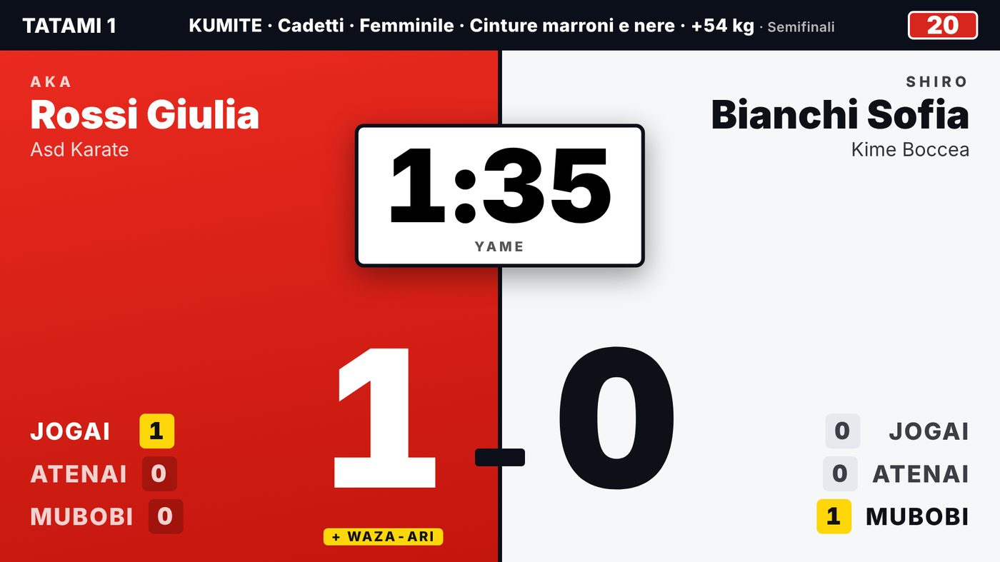

## Download

Ultima versione: **[v1.3.0](https://github.com/audiouser69-commits/karate-torneo-fesik/releases/tag/v1.3.0)**

| Sistema | File |
| --- | --- |
| Windows 10/11 | [KarateTorneoFESIK_Windows_v1.3.0.zip](https://github.com/audiouser69-commits/karate-torneo-fesik/releases/download/v1.3.0/KarateTorneoFESIK_Windows_v1.3.0.zip) |
| Mac con chip Apple (M1–M4) | [KarateTorneoFESIK_Mac_AppleSilicon_v1.3.0.zip](https://github.com/audiouser69-commits/karate-torneo-fesik/releases/download/v1.3.0/KarateTorneoFESIK_Mac_AppleSilicon_v1.3.0.zip) |
| Mac con processore Intel | [KarateTorneoFESIK_Mac_Intel_v1.3.0.zip](https://github.com/audiouser69-commits/karate-torneo-fesik/releases/download/v1.3.0/KarateTorneoFESIK_Mac_Intel_v1.3.0.zip) |

Guide in PDF:
[guida completa Windows](docs/Guida_Karate_Torneo_FESIK.pdf) ·
[guida completa Mac](docs/Guida_Karate_Torneo_FESIK_Mac.pdf) ·
[installazione Mac passo per passo](docs/Installazione_Mac_Apple_Silicon_Karate_Torneo_FESIK.pdf)

## Indice

1. [Cosa fa, in breve](#cosa-fa-in-breve)
2. [Installazione](#installazione)
3. [La giornata di gara](#la-giornata-di-gara)
4. [Torneo e import degli atleti](#torneo-e-import-degli-atleti)
5. [Categorie](#categorie)
6. [Sorteggio e formule di gara](#sorteggio-e-formule-di-gara)
7. [Tabellone degli incontri](#tabellone-degli-incontri)
8. [Incontro live: kumite](#incontro-live-kumite)
9. [Incontro live: kata](#incontro-live-kata)
10. [Il tabellone sul televisore](#il-tabellone-sul-televisore)
11. [Grafiche evento per il pubblico](#grafiche-evento-per-il-pubblico)
12. [Classifiche ed esportazione](#classifiche-ed-esportazione)
13. [Risultati online e pagina per il pubblico](#risultati-online-e-pagina-per-il-pubblico)
14. [Più tatami](#più-tatami)
15. [Regole modificabili](#regole-modificabili)
16. [Salvataggi](#salvataggi)
17. [Note e limiti](#note-e-limiti)
18. [Per sviluppatori](#per-sviluppatori)

## Cosa fa, in breve

| Funzione | Dettagli |
| --- | --- |
| Import atleti | Da Excel (.xlsx, .xls, .csv, .ods), con modello pronto da compilare |
| Categorie automatiche | Per specialità, classe d'età FESIK, sesso, cinture, peso (kumite), stile (kata) |
| Sorteggio | Atleti della stessa società tenuti lontani; bye automatici |
| Formule di gara | Finale diretta, girone all'italiana, eliminazione diretta con o senza recupero |
| Kumite | Shobu Sanbon, Nihon, Ippon; penalità Jogai, Atenai, Mubobi; Encho-sen, Sai Shiai, Hantei, Hikiwake |
| Kata | A punteggio (3 o 5 giudici, scarto del voto più alto e più basso) oppure a bandierine |
| Tabellone TV | Su televisore o monitor via HDMI, a schermo intero, con segnali sonori |
| Grafiche evento | Schermate per il pubblico con testo e figure in pixel art, programma delle fasi, QR code |
| Risultati online | Pagina pubblica gratuita con incontri in diretta, tabelloni, classifiche e medagliere |
| Esportazione | Classifiche, incontri e categorie in Excel |

Funziona anche senza internet: la rete serve solo per i risultati online.

## Installazione

**Windows:** estrai lo zip e apri `Karate Torneo FESIK.exe`. Il programma non ha una firma digitale a pagamento: se Windows mostra "PC protetto", clicca **Ulteriori informazioni → Esegui comunque**.

**Mac:** apri lo zip e trascina l'app nella cartella **Applicazioni**. Al primo avvio, se macOS la blocca, vai in **Impostazioni di Sistema → Privacy e sicurezza → Apri comunque**. Se dice che l'app "è danneggiata", esegui una volta nel Terminale:

```
xattr -cr "/Applications/Karate Torneo FESIK.app" && codesign --force --deep -s - "/Applications/Karate Torneo FESIK.app"
```

La [guida di installazione per Mac](docs/Installazione_Mac_Apple_Silicon_Karate_Torneo_FESIK.pdf) spiega ogni passaggio per chi non è esperto.

## La giornata di gara

**Prima della gara**

1. **Torneo:** nome, data, luogo, numero del tatami.
2. **Importa Excel** con la lista atleti.
3. **Regole:** controlla classi d'età, pesi e cinture con la circolare della gara.
4. **Genera categorie** e unisci quelle con un solo atleta.
5. **Account e online:** configura i risultati in diretta e pubblica la pagina (una volta sola).
6. **Grafiche evento:** prepara il programma delle fasi e le schermate per il pubblico.
7. **Salva torneo su file** come copia di sicurezza.

**Il giorno della gara**

1. Collega il televisore come schermo esteso e premi **Apri tabellone TV**.
2. **Sorteggia tutte** le categorie.
3. Nella scheda **Incontro live** carica un incontro, gestisci punti e tempo, premi **Conferma e registra**: il programma passa da solo al successivo.

## Torneo e import degli atleti

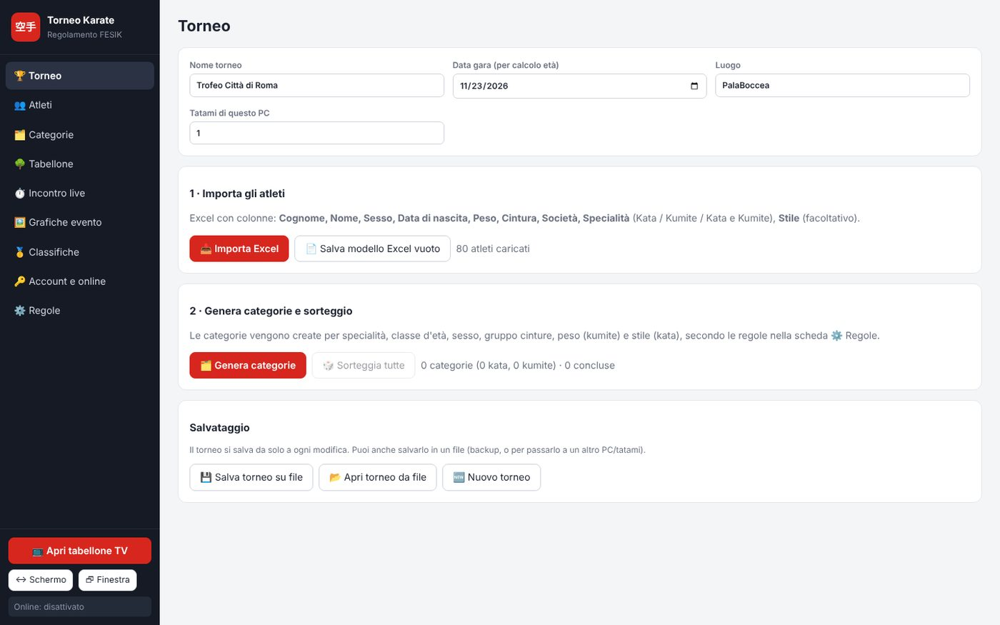

Il file Excel ha una riga per atleta. Il programma riconosce le colonne anche se scritte in modo diverso (es. "Società" o "Club").

| Colonna | Contenuto | Obbligatoria |
| --- | --- | --- |
| Cognome, Nome | Testo | Sì |
| Sesso | M o F | Sì |
| Data di nascita | gg/mm/aaaa o data Excel | Sì |
| Peso | kg (serve per il kumite) | Per il kumite |
| Cintura | Bianca, Gialla, Arancio, Verde, Blu, Marrone, Nera | Consigliata |
| Società | Nome della società | Consigliata |
| Specialità | Kata, Kumite, Kata e Kumite | Consigliata |
| Stile | Shotokan, Shito Ryu… | No |

L'età si calcola alla data della gara. Dopo l'import il programma segnala le righe con problemi. Gli atleti si possono aggiungere, modificare o eliminare a mano nella scheda **Atleti**.

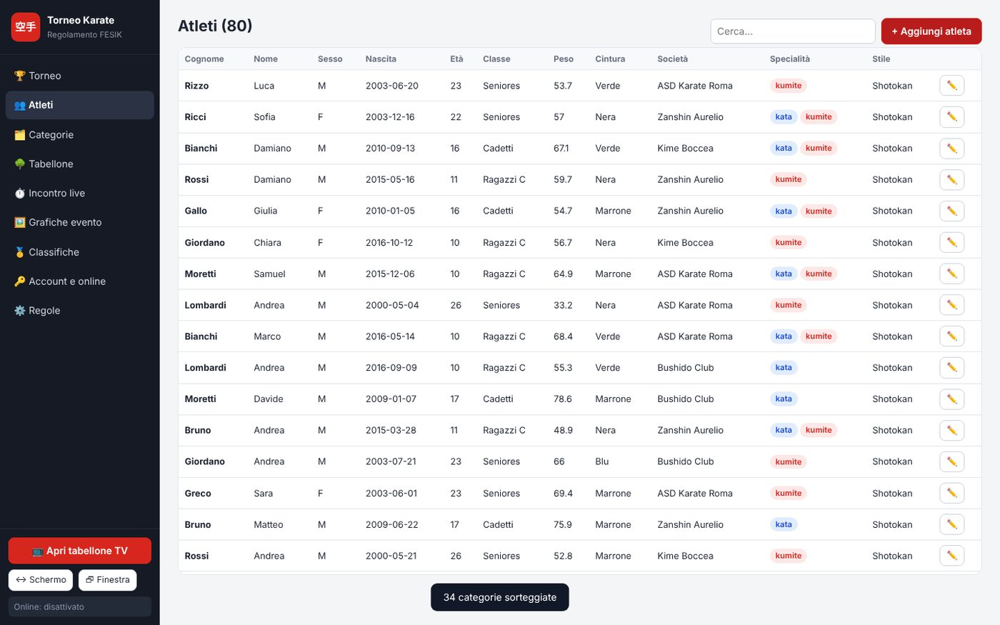

## Categorie

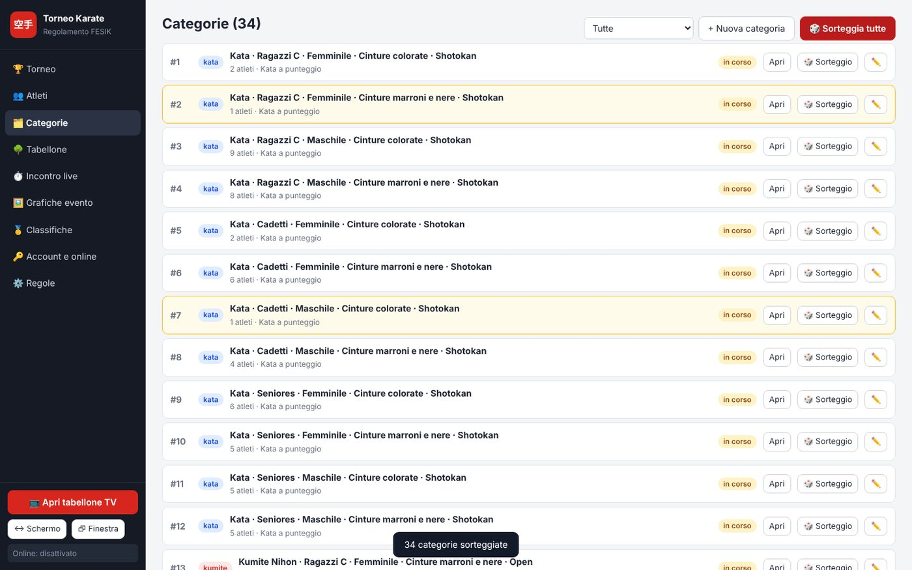

| Specialità | Divisione |
| --- | --- |
| Kumite | Classe d'età · sesso · gruppo cinture · categoria di peso; tipo di incontro dalla classe (Nihon fino a 13 anni, Sanbon dai 14) |
| Kata | Classe d'età · sesso · gruppo cinture · stile |

Ogni categoria ha un numero, che compare anche sul tabellone TV. Le categorie con meno di 2 atleti sono evidenziate. Con il pulsante ✏️ si può:

- rinominare la categoria e cambiare il tipo di kumite o il numero di finalisti del kata;
- **unirla a un'altra** categoria;
- aggiungere o togliere atleti;
- assegnarla a un tatami.

## Sorteggio e formule di gara

| Atleti | Formula | Classifica |
| --- | --- | --- |
| 1 | Atleta unico | 1° a tavolino |
| 2 | Finale diretta | 1° e 2° |
| fino a 3 (impostabile) | Girone all'italiana | 2 punti vittoria, 1 pareggio; poi scontro diretto e punti segnati |
| 4 o più | Eliminazione diretta con recupero (predefinita) | 1°, 2° e due 3° dai recuperi |
| 4 o più | Eliminazione diretta semplice | 1°, 2° e due 3° pari merito |
| Kata a punteggio | Eliminatorie → Semifinale → Finale | Dalla finale, poi dai turni precedenti |

- Gli atleti della stessa società vengono messi il più lontano possibile nel tabellone.
- **Recuperi:** quando sono noti i finalisti, gli atleti battuti da ciascun finalista vengono ripescati; i vincitori dei due recuperi sono terzi.

## Tabellone degli incontri

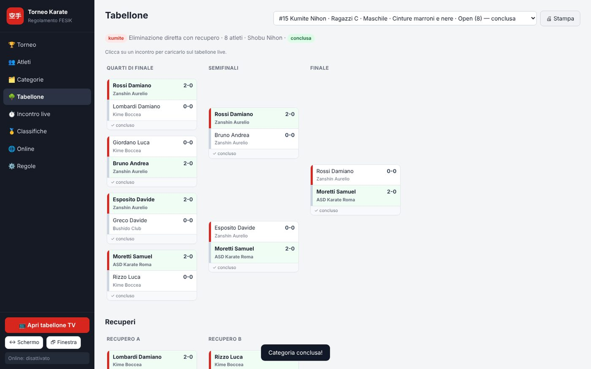

Mostra turni, recuperi o girone con punteggi e vincitori. Cliccando un incontro da disputare lo si carica nell'Incontro live. Un risultato già registrato si può annullare, se il turno successivo non è stato giocato. Il tabellone si può stampare.

## Incontro live: kumite

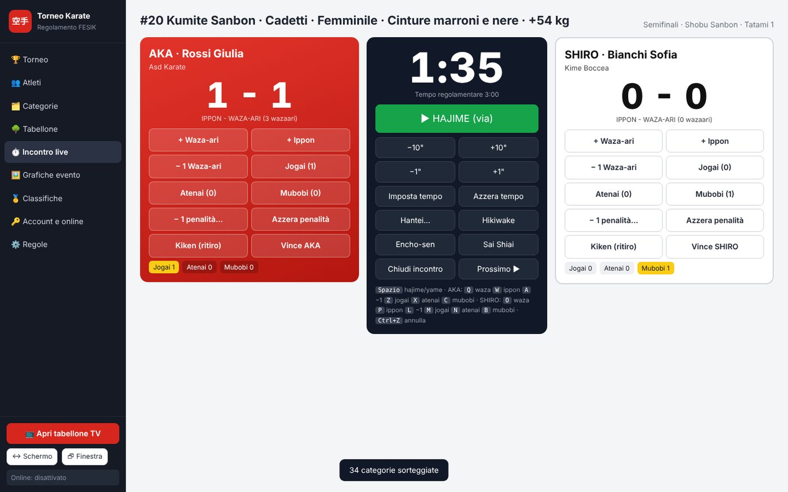

Si apre dalla scheda **Incontro live** (elenco "Prossimi incontri" → **Carica**) oppure cliccando un incontro nel Tabellone.

| Tasto | AKA (rosso) | Tasto | SHIRO (bianco) |
| --- | --- | --- | --- |
| Q | + Waza-ari | O | + Waza-ari |
| W | + Ippon | P | + Ippon |
| A | − 1 Waza-ari | L | − 1 Waza-ari |
| Z | Jogai | M | Jogai |
| X | Atenai | N | Atenai |
| C | Mubobi | B | Mubobi |

**Spazio** = Hajime / Yame · **Ctrl+Z** (Mac: Cmd+Z) = annulla l'ultima azione.

| Situazione | Cosa fa il programma |
| --- | --- |
| Punteggio pieno | Ferma il tempo e assegna la vittoria (Sanbon 3 Ippon, Nihon 2, Ippon 1) |
| Durata | Nihon 1:30; Sanbon/Ippon 2:00 in eliminatoria, 3:00 in semifinale e finale |
| Ultimi 30 secondi | Segnale acustico e scritta ATOSHI BARAKU |
| Fine tempo con vantaggio | Vince chi è avanti |
| Fine tempo in parità | Sanbon: Encho-sen 1 minuto · Ippon: Sai Shiai · Nihon: Hantei · girone: Hikiwake o Hantei |
| Penalità | Contatori Jogai, Atenai, Mubobi; le conseguenze le decide l'arbitro (pulsante "Vince AKA/SHIRO") |

Il risultato diventa definitivo con **Conferma e registra**; poi il programma carica da solo l'incontro successivo.

## Incontro live: kata

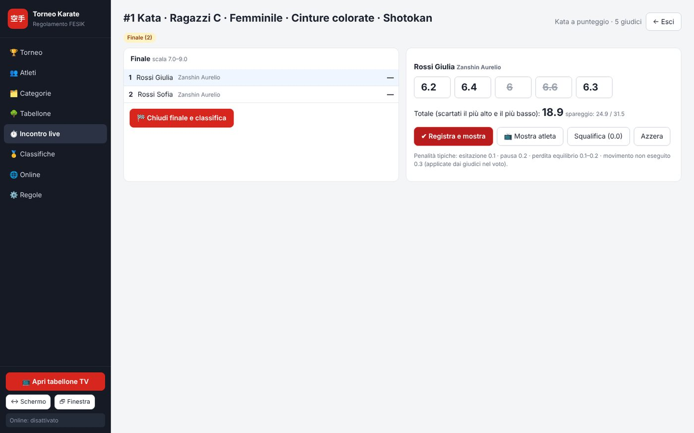

**A punteggio:** si seleziona l'atleta (sul televisore compaiono nome, società e cintura), si inseriscono i voti dei giudici e si registra. Il programma scarta il voto più alto e il più basso e somma gli altri; in parità conta il totale con il voto più basso, poi con il più alto.

| Turno | Scala dei voti |
| --- | --- |
| Eliminatorie | 5,0 – 7,0 |
| Semifinale | 6,0 – 8,0 |
| Finale | 7,0 – 9,0 |

Finalisti: 8 per i Ragazzi, 6 per le altre classi. Nei turni successivi gli atleti eseguono dal peggiore al migliore.

**A bandierine:** il kata si gioca a eliminazione; si sceglie l'esito (es. AKA 3 – 2 SHIRO) e lo si mostra sul tabellone.

## Il tabellone sul televisore

Collega il televisore via HDMI come **schermo esteso** (Windows: Win+P → Estendi; Mac: Impostazioni di Sistema → Monitor) e premi **📺 Apri tabellone TV**. Si apre a schermo intero sul televisore e si aggiorna da solo, senza bisogno di pubblicare nulla.

| Durante l'incontro | A fine incontro |
| --- | --- |
|  | 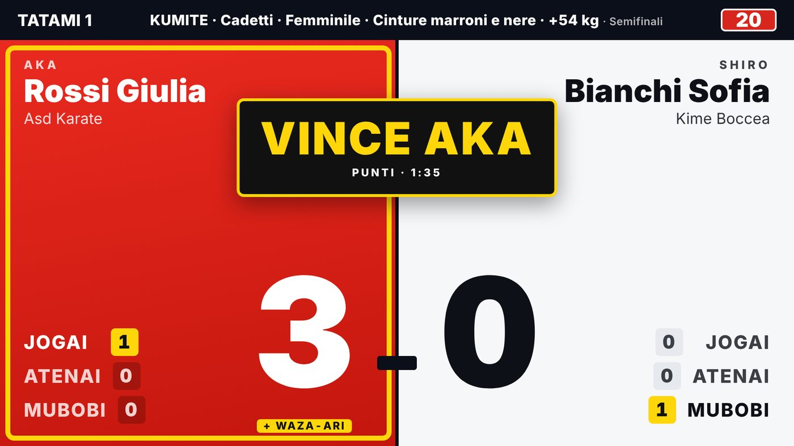 |

Disposizione del kumite:

- in alto il tatami, la categoria e il suo numero, preso in automatico;
- AKA a sinistra e SHIRO a destra, con nome e società;
- il tempo al centro;
- in basso le penalità JOGAI, ATENAI, MUBOBI e il punteggio. "+ WAZA-ARI" indica mezzo punto in più.

Il tabellone mostra anche kata, classifiche e, tra un incontro e l'altro, i prossimi incontri.

| Kata | Schermata di attesa |
| --- | --- |
| 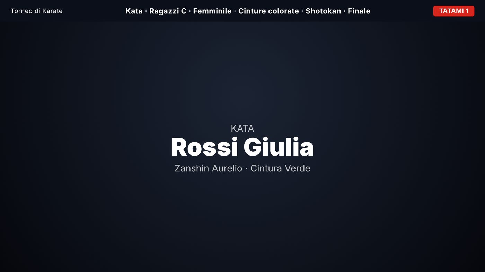 | 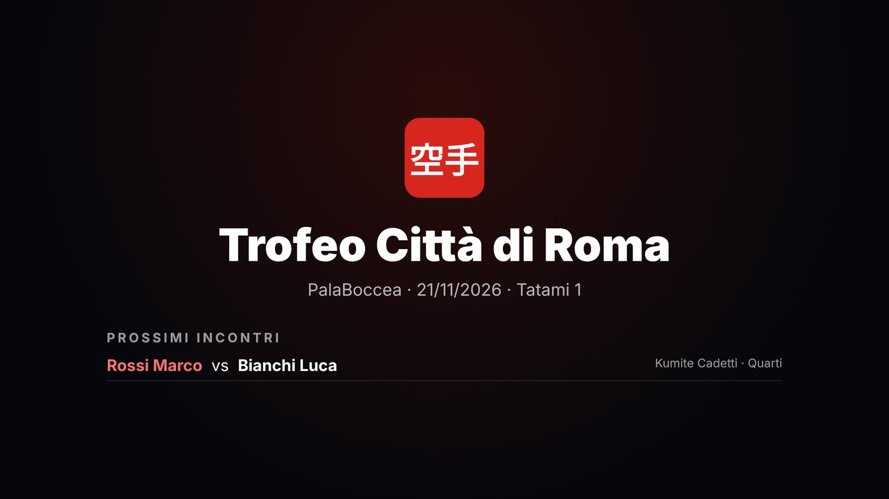 |

## Grafiche evento per il pubblico

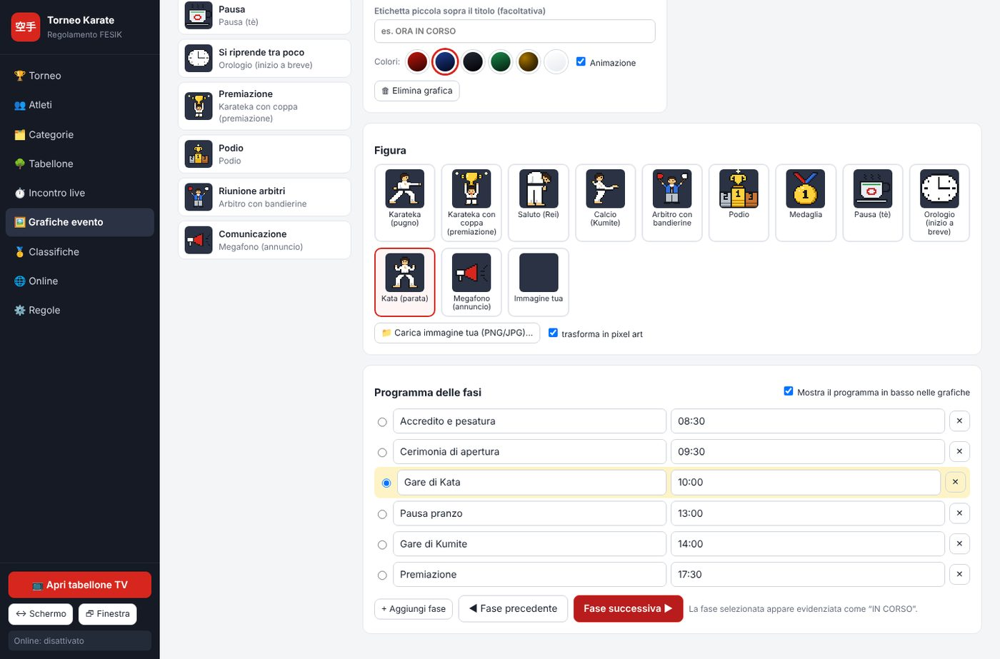

Schermate informative: il nome della fase (es. "Premiazione"), un sottotitolo e un testo, abbinati a una figura in pixel art.

- 11 figure originali: karateka, karateka con coppa, saluto, kata, calcio, arbitro, podio, medaglia, pausa, orologio, megafono. In più si può usare un'immagine propria, trasformabile in pixel art.
- 6 combinazioni di colori, animazione attivabile.
- **Programma delle fasi** con orari, mostrato in fondo alla grafica: la fase in corso è evidenziata. "Fase successiva" avanza e seleziona la grafica con lo stesso nome.
- **Manda in onda** la mostra sul televisore e sulla pagina live; **Torna al tabellone gare** rimette i punteggi.

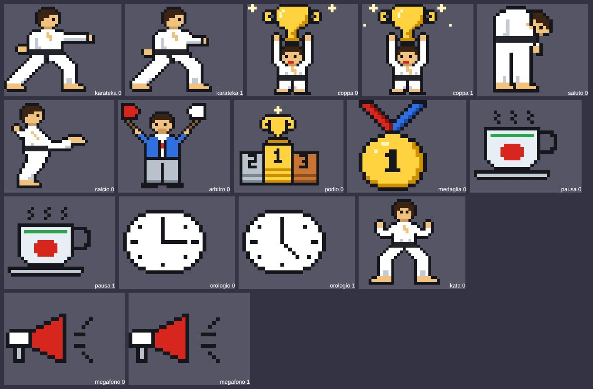

| Premiazione | QR code della pagina live |
| --- | --- |
| 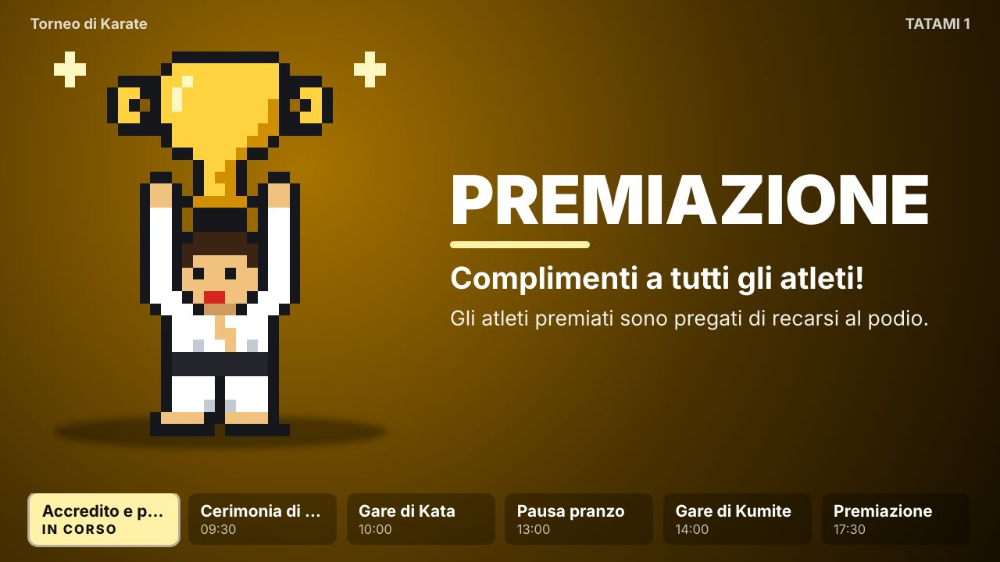 |  |

## Classifiche ed esportazione

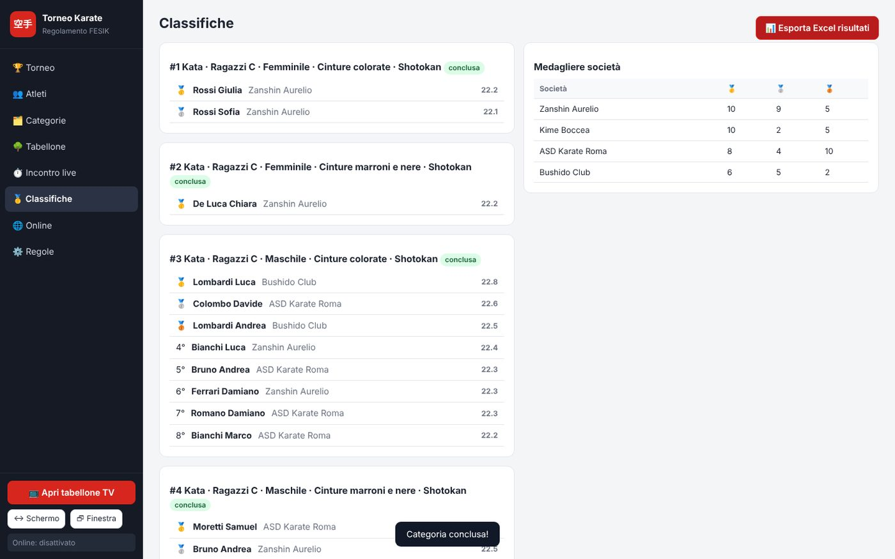

Podio di ogni categoria e **medagliere per società**. **Esporta Excel risultati** crea un file con tre fogli: Classifiche, Incontri (con punteggi e decisioni) e Categorie.

## Risultati online e pagina per il pubblico

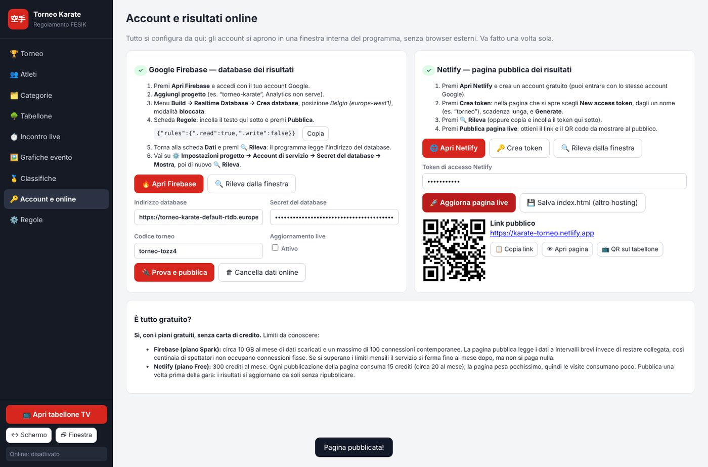

Si configura tutto dalla scheda **Account e online**, una volta sola. I siti dei servizi si aprono in una finestra interna del programma.

1. **Firebase (Google):** database dei risultati. Il programma rileva da solo l'indirizzo del database e la chiave.
2. **Netlify:** ospita la pagina pubblica. Con un token, il programma la pubblica e restituisce link e QR code.

| Incontro in diretta | Grafica in onda | Dettaglio categoria |
| --- | --- | --- |
| 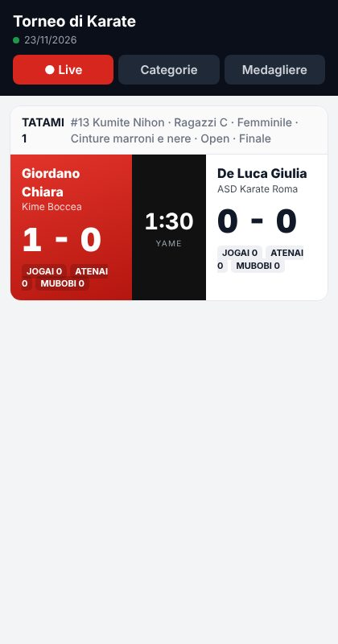 | 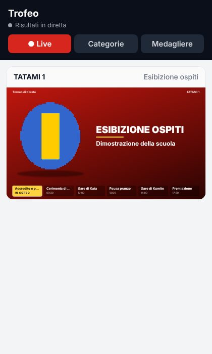 | 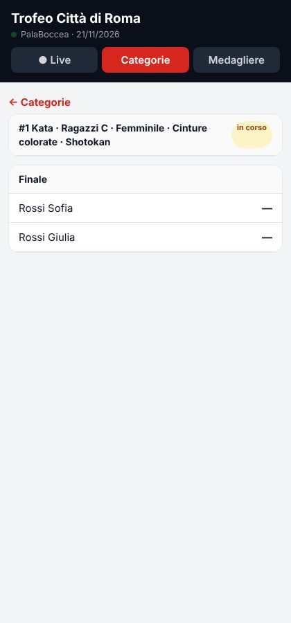 |

La pagina si apre da qualsiasi telefono, senza installare nulla, e ha tre sezioni:

- **Live:** un riquadro per tatami, con incontro in corso, grafica in onda o prossimi incontri.
- **Categorie:** con ricerca per atleta o società.
- **Medagliere.**

**Costi:** gratuito con i piani base, senza carta di credito.

- **Firebase (piano Spark):** circa 10 GB al mese e massimo 100 connessioni contemporanee. La pagina legge i dati a intervalli brevi, quindi regge molti spettatori.
- **Netlify (piano Free):** 300 crediti al mese, 15 per pubblicazione. Basta pubblicare la pagina una volta: i risultati poi si aggiornano da soli.
- Se si supera un limite il servizio si ferma, senza addebiti.

## Più tatami

1. Prepara il torneo su un PC e assegna ogni categoria a un tatami (✏️ → Tatami assegnato).
2. Salva il torneo su file e aprilo sugli altri PC.
3. Su ogni PC imposta il proprio numero di tatami, con lo stesso database online.

Ogni PC pubblica le proprie categorie e il proprio incontro: la pagina live mostra tutti i tatami insieme.

## Regole modificabili

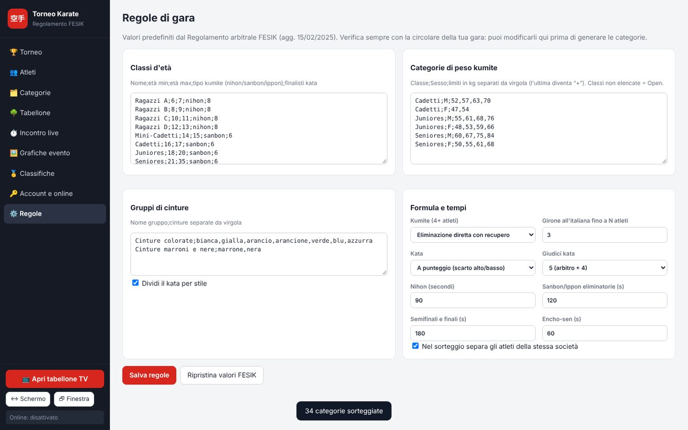

I valori predefiniti vengono dal Regolamento arbitrale FESIK aggiornato al 15/02/2025.

| Impostazione | Predefinito |
| --- | --- |
| Classi d'età | Ragazzi A–D (6–13 anni, Nihon), Mini-Cadetti, Cadetti, Juniores, Seniores, Veterani A e B (Sanbon) |
| Pesi | Cadetti, Juniores, Seniores; altre classi Open — **da verificare con la circolare della gara** |
| Cinture | Colorate · marroni e nere |
| Kumite con 4 o più atleti | Eliminazione diretta con recupero |
| Girone all'italiana | Fino a 3 atleti |
| Kata | A punteggio, 5 giudici, diviso per stile |
| Tempi | Nihon 90", eliminatorie 120", semifinali e finali 180", Encho-sen 60" |

## Salvataggi

- Il torneo si salva da solo a ogni modifica.
- **Salva torneo su file** crea una copia di sicurezza in .json, da passare anche ad altri PC.
- I dati di accesso a Netlify restano solo sul computer e non finiscono nel file del torneo.

## Note e limiti

- I valori di regolamento sono predefiniti modificabili: verificali sempre con la circolare della gara.
- Provato con un torneo simulato di 80 atleti e 34 categorie. Uso su televisore reale, Firebase e Netlify vanno provati prima della prima gara.
- Le app non hanno firma digitale a pagamento (Microsoft/Apple): il sistema le segnala al primo avvio.
- Le figure in pixel art sono originali, create per questo programma.

## Per sviluppatori

Applicazione [Electron](https://www.electronjs.org/) con interfaccia HTML/JavaScript.

```
npm install
npm start          # avvia in sviluppo
npm run dist:win   # pacchetto Windows x64
npm run dist:mac   # pacchetti macOS Apple Silicon e Intel
```

| File | Contenuto |
| --- | --- |
| `main.js`, `preload.js` | Finestre, file, finestra browser interna, pubblicazione su Netlify |
| `app/core.js` | Logica di gara: import, categorie, sorteggio, recuperi, girone, kata, regole dell'incontro |
| `app/app.js`, `app/index.html`, `app/style.css` | Interfaccia dell'operatore |
| `app/scoreboard.html` | Tabellone per il televisore |
| `app/pixelart.js`, `app/infoscreen.js` | Figure pixel art e schermate delle grafiche evento |
| `live/index.html` | Pagina pubblica dei risultati |
| `.github/workflows/release.yml` | Compilazione Windows/Mac e pubblicazione della release |

Per una nuova versione: aggiorna `version` in `package.json`, poi **Actions → Build e release → Run workflow**.

Librerie incluse: [SheetJS](https://sheetjs.com/) (Excel), [qrcode-generator](https://github.com/kazuhikoarase/qrcode-generator) (QR code).
